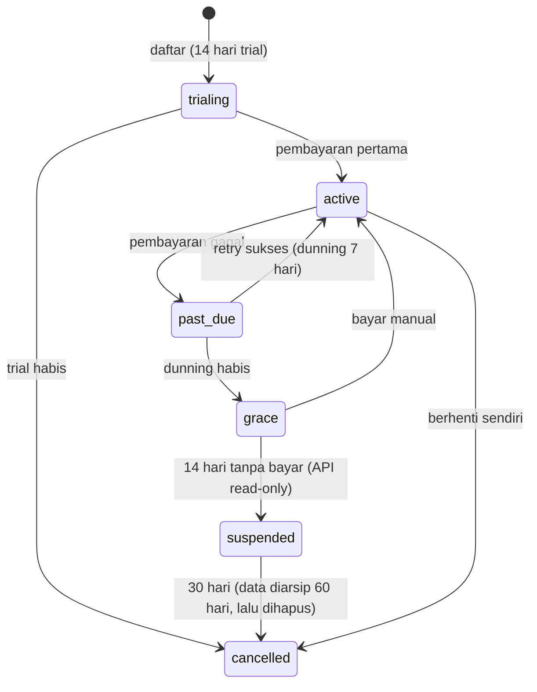

# 02 — Model Bisnis & Unit Economics

> Bagian dari [Kajian Produk Fablerace](../README.md) · Sebelumnya: [01 — Produk & Pasar](01-produk-dan-pasar.md) · Lanjut: [03 — Arsitektur](03-arsitektur.md)

## 1. Model Lisensi

**Unit jual: 1 lisensi = 1 tenant (1 situs/workspace) = $25/bulan.**

- Lisensi diwakili **license key** yang terikat ke tenant (tabel `licenses`, lihat [04 — Desain Data](04-desain-data.md)).
- Status lisensi menentukan akses: `active → past_due → grace → suspended → cancelled`.
- Enforcement dilakukan middleware di setiap request API (lihat [08 — Keamanan](08-keamanan.md) dan modul `license` pada scaffold).
- Agensi membeli banyak lisensi di bawah satu akun billing → diskon volume (lihat tier).

### Struktur Tier

| | **Starter** | **Pro (anchor)** | **Agency** |
|---|---|---|---|
| Harga | $9/bln | **$25/bln** | $20/bln/lisensi (min. 5 lisensi) |
| Konten | 500 item | Tak terbatas* | Tak terbatas* |
| Storage MinIO | 5 GB | 50 GB | 50 GB/lisensi, pooled |
| Anggota tim | 3 | 15 | 15/lisensi |
| API rate | 60 req/mnt | 300 req/mnt | 300 req/mnt |
| Keyword & SEO automation | Dasar (sitemap, RSS, slug) | Penuh (+ auto-meta, scheduled publishing, webhooks) | Penuh + white-label API |
| AI assist (saran keyword/meta) | — | Add-on $10/bln | Add-on $10/bln |
| Custom domain | 1 | 1 | 1/lisensi |

\* "Tak terbatas" dengan fair-use policy; batas teknis tetap dipantau lewat metering (lihat §4).

**Alasan desain tier**: Starter adalah pintu masuk & pembanding harga (decoy ke Pro); Pro ($25) adalah produk inti yang dijual; Agency mengunci segmen reseller dengan komitmen volume. Add-on AI menjadi jalur ekspansi ARPU tanpa menaikkan harga dasar.

### Siklus langganan



## 2. Payment Gateway

| Pasar | Pilihan | Catatan biaya (umum, 2025) |
|---|---|---|
| Global | **Paddle** (merchant of record) atau **Stripe Billing** | Paddle ~5% + $0.50 (termasuk urusan pajak global); Stripe ~2.9% + $0.30 (+ pajak diurus sendiri) |
| Indonesia | **Midtrans** atau **Xendit** (VA, QRIS, e-wallet) | ~1–2% + biaya tetap per metode |

**Rekomendasi**: mulai dengan **Paddle** untuk global (menghilangkan beban pajak/PPN lintas negara bagi tim kecil) + **Midtrans** untuk pembeli Indonesia. Abstraksi gateway di modul `license` (interface `PaymentProvider`) agar penyedia bisa ditukar.

## 3. Unit Economics (estimasi, asumsi eksplisit)

> Semua angka di bagian ini adalah **estimasi perencanaan** berbasis harga publik umum penyedia infrastruktur per 2025. Wajib divalidasi ulang dengan load test nyata ([10 — Roadmap](10-roadmap.md) fase MVP).

### Asumsi biaya infrastruktur

| Komponen | Asumsi | Biaya/bulan |
|---|---|---|
| 1 node aplikasi+DB (VPS 8 vCPU / 16 GB, kelas Hetzner/DO) | melayani ±150 tenant Pro aktif | $60 |
| Object storage (MinIO di node storage sendiri / S3-compatible) | rata-rata pemakaian riil 8 GB/tenant @ ~$0.02/GB | $0.16/tenant |
| Bandwidth/egress | 20 GB/tenant @ ~$0.01/GB (blended) | $0.20/tenant |
| Backup + monitoring + domain/SSL | amortisasi | $0.30/tenant |
| **Total infra per tenant Pro** | | **± $1,06** |

Kepadatan 150 tenant/node masuk akal karena proses Go idle hemat memori dan beban CMS didominasi read yang di-cache Redis ([03 — Arsitektur](03-arsitektur.md)); angka konservatifnya pun (75 tenant/node) hanya menaikkan biaya infra ke ±$1,5/tenant.

### Struktur margin per lisensi Pro ($25)

| Komponen | Nilai | % dari harga |
|---|---|---|
| Harga jual | $25,00 | 100% |
| Biaya payment (Paddle ~5% + $0.50) | −$1,75 | 7% |
| Infra per tenant | −$1,06 | 4% |
| Support (asumsi 0,2 jam/tenant/bln @ $15/jam) | −$3,00 | 12% |
| **Gross margin** | **± $19,19** | **± 77%** |

Gross margin 70–80% adalah wilayah sehat untuk SaaS; harga $25 **layak** secara unit economics bahkan dengan asumsi konservatif.

### Break-even sederhana

Asumsi biaya tetap bulanan tim kecil (2 engineer paruh-penuh + tooling + marketing dasar): **$6.000/bulan**.

```
Break-even = $6.000 / $19,19 gross margin ≈ 313 lisensi Pro aktif
```

| Milestone | Lisensi aktif | MRR | Status |
|---|---|---|---|
| Validasi | 50 | $1.250 | Tutup biaya infra + sebagian tooling |
| Break-even | ±315 | ±$7.900 | Tim kecil berkelanjutan |
| Skala | 1.000 | $25.000 | Rekrut support & engineer tambahan |

### LTV / CAC (target, bukan prediksi)

- Churn target segmen agensi: 2,5%/bulan → umur pelanggan ±40 bulan → **LTV ≈ 40 × $19 ≈ $760** per lisensi.
- Dengan disiplin LTV:CAC ≥ 3, anggaran akuisisi maksimum **±$250/lisensi** — sangat longgar untuk kanal content-led & komunitas; kanal berbayar tetap harus diuji per-kanal.

## 4. Metering & Enforcement

Yang diukur per tenant (tersimpan agregat, dipakai middleware & billing):

1. **Storage** — byte terpakai di prefix MinIO tenant (lihat [07 — Storage & Media](07-storage-media.md)).
2. **Jumlah konten** — enforcing kuota Starter.
3. **Seat** — jumlah baris `tenant_users` aktif.
4. **API rate** — token bucket per API key / tenant ([08 — Keamanan](08-keamanan.md)).

Pelanggaran kuota tidak memutus layanan seketika: beri status `over_limit` + notifikasi + masa tenggang 7 hari → dorongan upgrade, bukan hukuman. Ini keputusan produk: churn karena frustrasi lebih mahal daripada toleransi kuota singkat.

## 5. Jalur Revenue Kedua (opsional, pasca-v1)

- **Lisensi self-hosted/on-premise** (tahunan, mis. $990/tahun) untuk institusi — dimungkinkan karena arsitektur single-binary + docker-compose yang sama dengan SaaS ([09 — DevOps](09-devops.md)).
- **Add-on AI** (saran keyword, auto-meta berbasis LLM) $10/bln ([06 — Keyword & Automasi](06-keyword-seo-automasi.md) §5).
- **Marketplace template/theme** komisi 20% — hanya jika basis pengguna sudah besar.

---

Berikutnya: [03 — Arsitektur Sistem](03-arsitektur.md)
