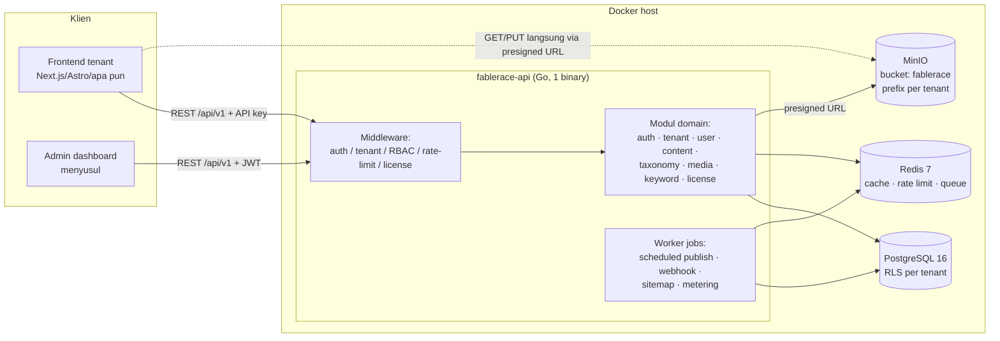

# 03 — Arsitektur Sistem

> Bagian dari [Kajian Produk Fablerace](../README.md) · Sebelumnya: [02 — Model Bisnis](02-model-bisnis.md) · Lanjut: [04 — Desain Data](04-desain-data.md)

## 1. Stack & Alasan Pemilihan

| Lapisan | Pilihan | Alasan |
|---|---|---|
| Bahasa | **Go 1.24+** | Binary tunggal, footprint memori kecil (kepadatan tenant tinggi → margin, lihat [02 §3](02-model-bisnis.md)), concurrency murah untuk background jobs |
| HTTP router | **chi v5** | Idiomatik `net/http`, middleware komposabel, tanpa magic — selaras tujuan clean code |
| Akses DB | **pgx v5** (pool) | Driver PostgreSQL tercepat & paling lengkap; query eksplisit tanpa ORM menjaga kontrol atas RLS & index |
| Migrasi | **golang-migrate** (embed via `iofs`) | Migrasi SQL polos, dijalankan otomatis saat boot → `docker compose up` langsung siap |
| Database | **PostgreSQL 16** | RLS untuk isolasi tenant, FTS bawaan untuk search awal, JSONB untuk meta fleksibel |
| Cache & queue | **Redis 7** | Cache read-heavy (konten terbit, sitemap), rate limit, serta backend antrian jobs (asynq) |
| Object storage | **MinIO** (S3-compatible) | Media library; API S3 → bisa pindah ke S3/R2 tanpa ubah kode |
| Auth | **JWT (HMAC) access + refresh token** + API key per tenant | Stateless untuk skala horizontal; detail di [08 — Keamanan](08-keamanan.md) |
| Kontainer | **Docker / docker-compose** | Dev–prod paritas; single-node prod cukup sampai ratusan tenant ([09 — DevOps](09-devops.md)) |

Yang sengaja **tidak** dipakai: ORM berat (GORM) — menyembunyikan query & menyulitkan RLS; microservices — overhead operasional tidak sepadan sebelum ribuan tenant. Arsitekturnya **monolith modular**: modul domain terpisah ketat di level paket (lihat [lampiran-b — Konvensi Kode](lampiran-b-konvensi-kode.md)), sehingga pemecahan ke service terpisah di masa depan adalah pemindahan folder, bukan penulisan ulang.

## 2. Diagram Arsitektur



## 3. Strategi Multi-Tenancy

**Keputusan: shared database + kolom `tenant_id` + PostgreSQL Row-Level Security (RLS).**

| Pendekatan | Biaya operasional | Isolasi | Kepadatan | Cocok untuk |
|---|---|---|---|---|
| **Shared DB + tenant_id + RLS** ✅ | Rendah (1 DB, 1 migrasi) | Baik (aplikasi + RLS dua lapis) | Sangat tinggi | SaaS harga rendah-menengah ($25) |
| Schema-per-tenant | Sedang (migrasi × N schema) | Lebih baik | Sedang | Ratusan tenant bernilai tinggi |
| DB-per-tenant | Tinggi | Terbaik | Rendah | Enterprise/regulated |

Alasan utama ekonomis: di harga $25/bln, margin bergantung pada kepadatan tenant per node ([02 §3](02-model-bisnis.md)). RLS memberi jaring pengaman kedua — meskipun ada bug aplikasi yang lupa memfilter `tenant_id`, Postgres menolak baris milik tenant lain karena `SET LOCAL app.tenant_id` di-set per transaksi oleh lapisan database ([08 — Keamanan §3](08-keamanan.md)).

**Jalur evolusi** (didokumentasikan sejak awal agar tidak menjadi jalan buntu): tenant enterprise dapat dipindah ke DB terpisah karena semua query sudah lewat repository per modul — cukup arahkan pool koneksi berbeda per tenant di lapisan `platform/database`.

## 4. Desain API

- **REST JSON, versi di path**: `/api/v1/...` — versi baru = mount router baru, versi lama tetap hidup selama masa deprekasi.
- **Identifikasi tenant**: header `X-Tenant-ID` (UUID) atau subdomain `{slug}.fablerace.app` (resolusi di middleware `tenant`); API key sudah terikat tenant sehingga cukup satu kredensial.
- **Autentikasi**: `Authorization: Bearer <JWT>` (user dashboard) atau `X-API-Key` (konsumsi konten dari frontend).
- **Envelope respons konsisten** (diimplementasi `internal/shared/response`):

```json
{ "success": true,  "data": {...}, "meta": { "page": 1, "per_page": 20, "total": 134 } }
{ "success": false, "error": { "code": "content_not_found", "message": "..." } }
```

- **Pagination**: `?page=&per_page=` (default 20, maks 100) — cukup untuk MVP; cursor-based menyusul untuk feed besar (ditandai `NEXT:` di kode).
- **Idempotency**: header `Idempotency-Key` untuk POST billing/webhook (pasca-MVP).
- **OpenAPI**: spec dihasilkan dan di-serve di `/api/v1/openapi.json` (pasca-MVP; sketsa endpoint manual di [lampiran-a](lampiran-a-api.md)).

## 5. Background Jobs

Antrian berbasis Redis (library **asynq**) dengan worker di binary yang sama (flag `--worker`), dipisah proses saat skala naik:

| Job | Pemicu | Catatan |
|---|---|---|
| `content:publish_scheduled` | cron tiap menit | Terbitkan konten `scheduled` yang jatuh tempo ([06 §3](06-keyword-seo-automasi.md)) |
| `seo:rebuild_sitemap` | event publish/unpublish | Hasil disimpan ke Redis + MinIO |
| `webhook:deliver` | event domain | Retry eksponensial, catat di `webhook_deliveries` |
| `media:process` | upload selesai | Thumbnail/resize ([07 §4](07-storage-media.md)) |
| `billing:metering` | cron harian | Agregasi storage/konten/seat per tenant ([02 §4](02-model-bisnis.md)) |

## 6. Caching

- **Read-through cache** di Redis untuk: konten published by slug (TTL 5 menit + invalidasi saat update), sitemap, klasemen keyword.
- Kunci cache selalu berprefix tenant: `t:{tenant_id}:content:{slug}` — mencegah kebocoran lintas tenant di lapisan cache juga.

---

Berikutnya: [04 — Desain Data & ERD](04-desain-data.md)
