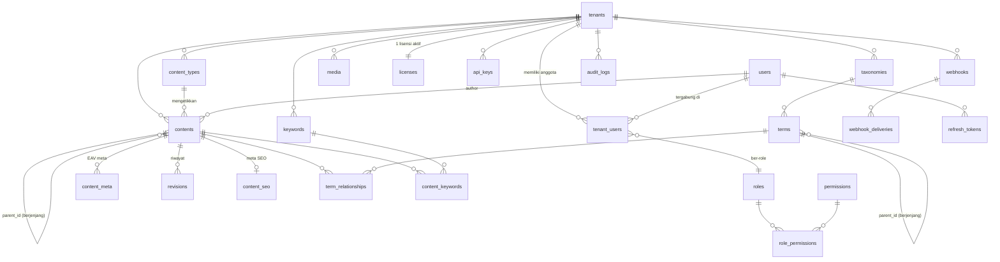

# 04 — Desain Data & ERD

> Bagian dari [Kajian Produk Fablerace](../README.md) · Sebelumnya: [03 — Arsitektur](03-arsitektur.md) · Lanjut: [05 — RBAC](05-rbac.md)

Model data meniru pola yang terbukti di WordPress (`wp_posts`, `wp_postmeta`, `wp_terms`, `wp_term_taxonomy`, `wp_term_relationships`) namun dinormalisasi lebih rapi, ber-UUID, dan sadar-tenant di setiap baris. Seluruh tabel diwujudkan di migrasi [`migrations/0001_init.up.sql`](../migrations/0001_init.up.sql).

## 1. ERD Inti



## 2. Tabel per Kelompok

### 2.1 Identitas & Akses (modul `tenant`, `user`, `auth` — detail role di [05 — RBAC](05-rbac.md))

| Tabel | Kolom kunci | Catatan |
|---|---|---|
| `tenants` | `id uuid PK`, `name`, `slug UNIQUE`, `custom_domain`, `status`, `settings jsonb` | 1 tenant = 1 situs = 1 lisensi |
| `users` | `id uuid PK`, `email UNIQUE`, `password_hash`, `name`, `is_platform_admin` | User global — satu akun bisa anggota banyak tenant |
| `tenant_users` | `tenant_id FK`, `user_id FK`, `role_id FK`, UNIQUE(tenant, user) | Keanggotaan + role per tenant (dasar seat metering) |
| `roles` | `id`, `tenant_id NULL`, `slug`, `name` | `tenant_id NULL` = role sistem (seed); tenant dapat membuat role kustom |
| `permissions` | `id`, `slug UNIQUE` | Daftar izin atomik (`content.publish`, dst.) |
| `role_permissions` | `role_id`, `permission_id` | Matriks role→izin |
| `refresh_tokens` | `id`, `user_id`, `token_hash`, `expires_at`, `revoked_at` | Rotasi refresh token ([08 §2](08-keamanan.md)) |

### 2.2 Konten Berjenjang ala WordPress (modul `content`)

| Tabel | Kolom kunci | Padanan WordPress |
|---|---|---|
| `content_types` | `id`, `tenant_id`, `slug`, `name`, `is_hierarchical` | `post_type` (post, page, custom) — tapi sebagai baris data, bukan hardcode |
| `contents` | `id uuid`, `tenant_id`, `content_type_id`, **`parent_id` self-FK**, `author_id`, `title`, `slug`, `excerpt`, `body`, `status`, `published_at`, `scheduled_at`, `deleted_at`, UNIQUE(tenant, type, slug) | `wp_posts` + `post_parent` |
| `content_meta` | `id`, `content_id`, `meta_key`, `meta_value jsonb`, UNIQUE(content, key) | `wp_postmeta` — EAV; `jsonb` agar nilai terstruktur tetap query-able |
| `revisions` | `id`, `content_id`, `author_id`, `title`, `body`, `excerpt`, `meta_snapshot jsonb` | Revisi sebagai snapshot, bukan baris di `contents` (lebih bersih dari WP) |
| `content_seo` | `content_id PK`, `meta_title`, `meta_description`, `canonical_url`, `og_image_media_id`, `noindex` | Dipisah dari meta EAV karena selalu dibaca bersama konten ([06](06-keyword-seo-automasi.md)) |

**Status konten** (enum): `draft → review → scheduled → published → archived`, plus `trashed` (soft delete via `deleted_at`).

**Hierarki**: query turunan memakai recursive CTE (`WITH RECURSIVE`); kedalaman dibatasi aplikasi (maks 10 level) untuk melindungi performa. Breadcrumb/path tidak disimpan denormalisasi dulu — `NEXT:` di kode menandai opsi kolom `path ltree` bila profil query menuntut.

### 2.3 Taxonomy Berjenjang (modul `taxonomy`)

| Tabel | Kolom kunci | Padanan WordPress |
|---|---|---|
| `taxonomies` | `id`, `tenant_id`, `slug`, `name`, `is_hierarchical` | `taxonomy` (category = hierarkis, tag = datar, kustom bebas) |
| `terms` | `id`, `tenant_id`, `taxonomy_id`, **`parent_id` self-FK**, `name`, `slug`, UNIQUE(taxonomy, slug) | `wp_terms` + `wp_term_taxonomy` digabung (normalisasi WP yang terkenal canggung) |
| `term_relationships` | `content_id`, `term_id`, PK gabungan | `wp_term_relationships` |

### 2.4 Media (modul `media` — detail di [07 — Storage](07-storage-media.md))

| Tabel | Kolom kunci |
|---|---|
| `media` | `id`, `tenant_id`, `uploader_id`, `file_name`, `object_key` (path MinIO), `mime_type`, `size_bytes`, `width`, `height`, `alt_text`, `variants jsonb` (thumbnail dsb.) |

### 2.5 Keyword & SEO (modul `keyword` — detail di [06](06-keyword-seo-automasi.md))

| Tabel | Kolom kunci |
|---|---|
| `keywords` | `id`, `tenant_id`, `phrase`, UNIQUE(tenant, phrase) |
| `content_keywords` | `content_id`, `keyword_id`, `is_primary` — 1 keyword utama per konten |

### 2.6 Platform & Billing (modul `license`)

| Tabel | Kolom kunci |
|---|---|
| `licenses` | `id`, `tenant_id UNIQUE`, `license_key UNIQUE`, `plan`, `seats`, `status`, `current_period_start/end`, `provider`, `provider_ref` |
| `billing_events` | `id`, `license_id`, `type`, `payload jsonb` — jejak webhook payment gateway |
| `api_keys` | `id`, `tenant_id`, `name`, `key_hash` (tidak pernah plaintext), `scopes text[]`, `expires_at`, `last_used_at` |
| `webhooks` | `id`, `tenant_id`, `url`, `events text[]`, `secret`, `is_active` |
| `webhook_deliveries` | `id`, `webhook_id`, `event`, `payload jsonb`, `status`, `attempts`, `last_attempt_at` |
| `audit_logs` | `id`, `tenant_id`, `user_id`, `action`, `entity_type`, `entity_id`, `changes jsonb`, `ip`, `user_agent` |

## 3. Strategi Index & Slug

- Setiap tabel ber-`tenant_id` diindeks komposit yang dimulai `tenant_id` — pola akses selalu per-tenant: `(tenant_id, status, published_at DESC)` untuk listing, `(tenant_id, content_type_id, slug)` UNIQUE untuk resolve URL.
- `content_meta(meta_key)` + GIN pada `meta_value` untuk query meta terstruktur.
- FTS: kolom generated `search_vector tsvector` pada `contents` + index GIN ([06 §4](06-keyword-seo-automasi.md)).
- **Slug otomatis**: dinormalisasi dari judul (`internal/shared/slugutil`), unik per (tenant, content_type); bentrok → sufiks `-2`, `-3`. Mengubah slug konten published akan mencatat redirect (tabel `slug_redirects` — pasca-MVP, ditandai `NEXT:` di modul content).

## 4. Row-Level Security

Semua tabel ber-`tenant_id` diberi policy:

```sql
ALTER TABLE contents ENABLE ROW LEVEL SECURITY;
CREATE POLICY tenant_isolation ON contents
  USING (tenant_id = current_setting('app.tenant_id', true)::uuid);
```

Aplikasi men-set `SET LOCAL app.tenant_id = '<uuid>'` di awal tiap transaksi (helper di `internal/platform/database`). Koneksi aplikasi memakai role non-superuser agar policy berlaku. Detail ancaman di [08 — Keamanan §3](08-keamanan.md).

---

Berikutnya: [05 — RBAC & Multi-Role](05-rbac.md)
