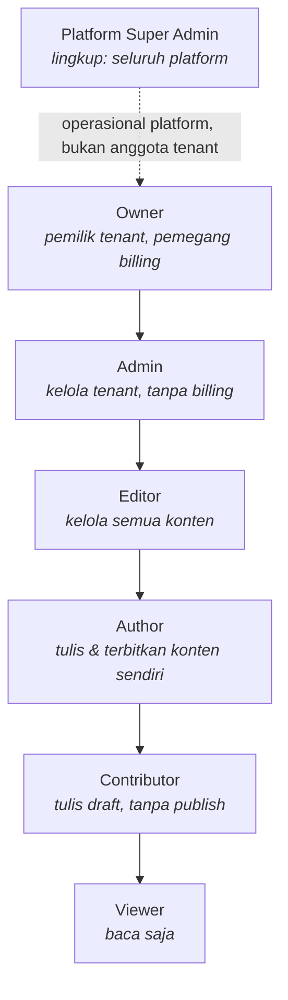
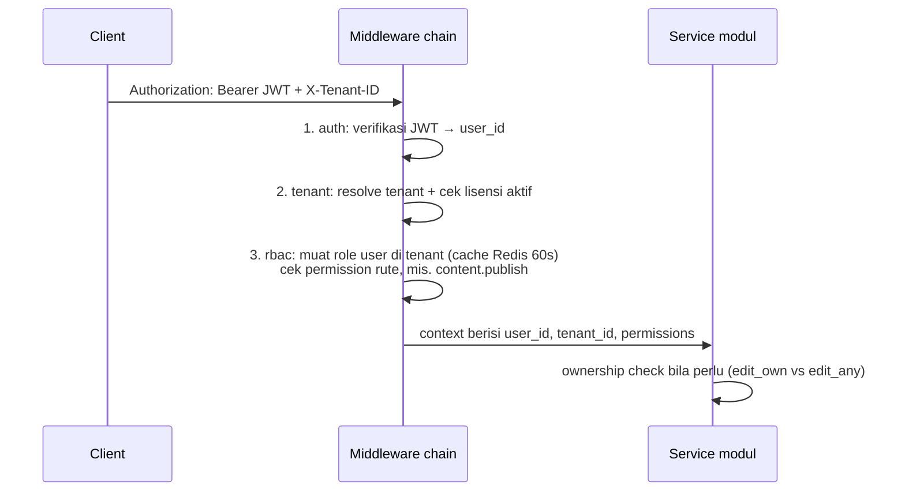

# 05 — RBAC & Multi-Role Access

> Bagian dari [Kajian Produk Fablerace](../README.md) · Sebelumnya: [04 — Desain Data](04-desain-data.md) · Lanjut: [06 — Keyword & Automasi](06-keyword-seo-automasi.md)

## 1. Hierarki Role

Dua lingkup role yang terpisah tegas:

- **Platform Super Admin** (`users.is_platform_admin = true`) — tim Fablerace sendiri: kelola tenant, suspensi lisensi, support. Tidak pernah diberikan ke pelanggan.
- **Role tenant** (6 level) mengikuti pola WordPress yang sudah dipahami pasar, ditambah `Owner` (pemegang kontrak/billing) dan `Viewer` (kebutuhan agensi: klien boleh melihat tanpa menyentuh).

Role disimpan sebagai **data** (`roles`, `role_permissions` — lihat [04 §2.1](04-desain-data.md)), bukan konstanta kode: role sistem di-seed migrasi dengan `tenant_id NULL`; tenant Pro/Agency dapat menggandakan role sistem menjadi role kustom (fitur pasca-MVP, ditandai `NEXT:` di modul `user`).

## 2. Permission Matrix

Izin bersifat atomik `resource.action`. Seed lengkap ada di [`migrations/0001_init.up.sql`](../migrations/0001_init.up.sql).

| Permission | Owner | Admin | Editor | Author | Contributor | Viewer |
|---|:-:|:-:|:-:|:-:|:-:|:-:|
| `content.view` | ✅ | ✅ | ✅ | ✅ | ✅ | ✅ |
| `content.create` | ✅ | ✅ | ✅ | ✅ | ✅ | — |
| `content.edit_own` | ✅ | ✅ | ✅ | ✅ | ✅ | — |
| `content.edit_any` | ✅ | ✅ | ✅ | — | — | — |
| `content.publish` | ✅ | ✅ | ✅ | ✅ (milik sendiri) | — | — |
| `content.delete` | ✅ | ✅ | ✅ | — | — | — |
| `taxonomy.manage` | ✅ | ✅ | ✅ | — | — | — |
| `media.upload` | ✅ | ✅ | ✅ | ✅ | ✅ | — |
| `media.manage` | ✅ | ✅ | ✅ | — | — | — |
| `keyword.manage` | ✅ | ✅ | ✅ | — | — | — |
| `user.invite` | ✅ | ✅ | — | — | — | — |
| `user.manage` | ✅ | ✅ | — | — | — | — |
| `apikey.manage` | ✅ | ✅ | — | — | — | — |
| `webhook.manage` | ✅ | ✅ | — | — | — | — |
| `settings.manage` | ✅ | ✅ | — | — | — | — |
| `billing.view` | ✅ | — | — | — | — | — |
| `billing.manage` | ✅ | — | — | — | — | — |

Catatan desain:
- `content.publish` untuk Author dibatasi "milik sendiri" — aturan gabungan permission + ownership check di service layer (bukan murni RBAC); pola yang sama dengan WordPress `publish_posts` vs `edit_others_posts`.
- `billing.*` eksklusif Owner — admin agensi tidak boleh melihat harga yang dibayar klien (kasus white-label).

## 3. Strategi Implementasi

**Keputusan: tabel permission custom + middleware, tanpa Casbin.**

| | Tabel custom + middleware ✅ | Casbin |
|---|---|---|
| Kompleksitas | Rendah — 3 tabel, 1 middleware, query ter-cache | Sedang — DSL policy, adapter, model file |
| Kebutuhan Fablerace | RBAC datar per tenant + ownership check | Mendukung ABAC/RBAC kompleks yang belum dibutuhkan |
| Debuggability | SQL biasa, mudah diaudit | Lapisan abstraksi tambahan |

Casbin layak ditinjau ulang bila muncul kebutuhan policy per-objek yang rumit (mis. izin per-folder media) — keputusan ini dicatat sebagai `NEXT:` di `internal/platform/middleware/rbac.go`.

### Alur request

Implementasi di scaffold:
- `internal/platform/middleware/auth.go` — verifikasi JWT, inject `user_id` ke context.
- `internal/platform/middleware/tenant.go` — resolve `X-Tenant-ID`, validasi keanggotaan, inject `tenant_id`.
- `internal/platform/middleware/rbac.go` — `RequirePermission("content.publish")` sebagai guard per-route; permission set user di-cache.
- Ownership check contoh nyata ada di `internal/modules/content/service.go` (exemplar).

## 4. API Key vs User Role

API key ([04 §2.6](04-desain-data.md)) membawa `scopes` sendiri (subset permission, umumnya read-only `content.view`) dan **tidak** melewati jalur role user — frontend publik tenant hanya perlu membaca konten published. Scope tulis pada API key hanya untuk integrasi server-to-server dan wajib dipilih eksplisit saat pembuatan key.

---

Berikutnya: [06 — Keyword & Automasi SEO](06-keyword-seo-automasi.md)
