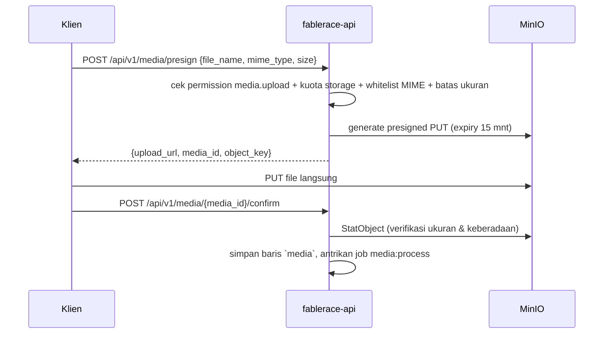

# 07 — Storage & Media (MinIO)

> Bagian dari [Kajian Produk Fablerace](../README.md) · Sebelumnya: [06 — Keyword & Automasi](06-keyword-seo-automasi.md) · Lanjut: [08 — Keamanan](08-keamanan.md)

## 1. Topologi Bucket

**Keputusan: satu bucket (`fablerace`) + prefix per tenant**, bukan bucket-per-tenant.

```
fablerace/
└── t/{tenant_id}/
    ├── media/{yyyy}/{mm}/{media_id}/original.{ext}
    ├── media/{yyyy}/{mm}/{media_id}/thumb_640.webp
    ├── media/{yyyy}/{mm}/{media_id}/thumb_1280.webp
    └── seo/sitemap.xml
```

| | Prefix per tenant ✅ | Bucket per tenant |
|---|---|---|
| Batas teknis | Tanpa batas praktis | MinIO/S3 membatasi jumlah bucket & memperlambat operasi listing global |
| Provisioning tenant baru | Nol kerja (hanya konvensi path) | Buat bucket + policy per tenant |
| Metering storage | `ListObjects` per prefix / agregat tabel `media` | Per bucket (lebih mudah, tapi tak sepadan) |
| Isolasi | Ditegakkan aplikasi: `object_key` selalu dibangun dari `tenant_id` context — klien tidak pernah mengirim path | Ditegakkan storage |

Isolasi lapisan storage tetap terjaga karena **tidak ada API yang menerima `object_key` dari klien**; key selalu dikonstruksi server-side dari `tenant_id` dalam context (helper `internal/platform/storage`, komentar `RELASI:` menunjuk middleware tenant).

## 2. Alur Upload (presigned URL — file tidak lewat API server)



Keuntungan: API server tidak memikul bandwidth upload (penting untuk kepadatan tenant per node, [02 §3](02-model-bisnis.md)); MinIO menegakkan expiry & ukuran lewat policy presigned.

**Download/serve**: media publik dilayani lewat presigned GET ber-TTL panjang di belakang CDN/reverse-proxy cache; media privat (draft) presigned GET pendek per permintaan.

## 3. Validasi & Kuota

- Whitelist MIME: gambar (jpeg/png/webp/avif/gif), dokumen (pdf), video (mp4, batas lebih ketat). Deteksi dari magic bytes saat `confirm`, bukan sekadar ekstensi (pelajaran dari pola validasi anti-exploit yang sama di proyek SIMPORA).
- Batas ukuran per file: 10 MB (gambar/dokumen), 100 MB (video, khusus Pro+).
- Kuota per lisensi (5/50 GB — [02 §1](02-model-bisnis.md)): dihitung dari agregat `media.size_bytes` per tenant (cepat) + rekonsiliasi harian terhadap MinIO oleh job metering (akurat).

## 4. Image Processing

Job `media:process` (worker, [03 §5](03-arsitektur.md)): generate varian WebP 640/1280 px memakai library Go murni (`disintegration/imaging` → `NEXT:` evaluasi libvips bila beban nyata menuntut); hasil dicatat di `media.variants jsonb`. Alternatif arsitektural bila ingin on-the-fly resize: **imgproxy** sebagai container tambahan — ditunda sampai ada kebutuhan nyata (satu stateful service lagi = biaya operasional).

## 5. Lifecycle, Backup & Portabilitas

- **Lifecycle MinIO**: objek di prefix tenant `cancelled` dihapus otomatis setelah masa arsip 60 hari ([02 §1](02-model-bisnis.md) siklus langganan) via object lifecycle rule + job pembersih.
- **Backup**: `mc mirror` harian ke bucket/situs kedua (atau replikasi MinIO site-to-site saat multi-node); DB dan storage di-backup dengan jadwal yang sama agar restore konsisten ([09 — DevOps](09-devops.md)).
- **Portabilitas**: karena API S3-compatible, migrasi ke AWS S3/Cloudflare R2 hanya mengganti endpoint & kredensial di config — tidak ada kode yang berubah (`internal/platform/storage` satu-satunya titik kontak).

---

Berikutnya: [08 — Keamanan](08-keamanan.md)
